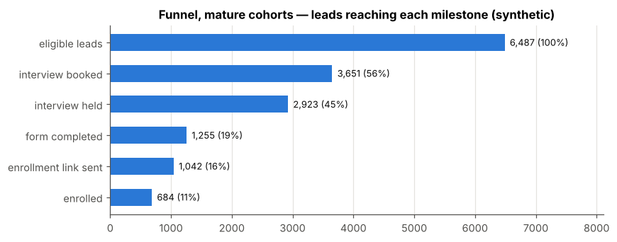
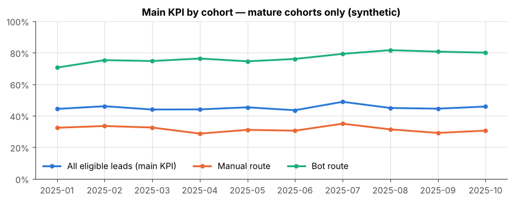
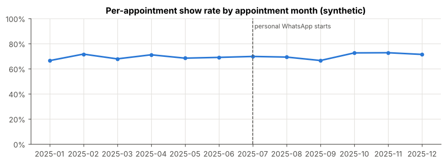

**Idioma:** [English](README.md) | Español

# Analítica CRM de admisiones — un caso sintético de admisiones B2C

Un proyecto de portfolio de **analítica CRM, sales operations y revenue operations**. Modela el funnel de admisiones de un negocio B2C de certificados online (lead → contacto → entrevista de admisión → formulario → enlace de matrícula → matrícula), lo mide con definiciones de KPI explícitas y probadas, y comprueba que las cifras se pueden reproducir byte a byte.

> ⚠️ **Todos los datos son 100 % sintéticos.** La estructura del proceso procede de experiencia operativa real y anonimizada; cada fila, tasa, importe y resultado se genera a partir de parámetros sintéticos de escenario (semilla 42). Nada describe una empresa, equipo, programa, alumno o mercado reales, y no se hacen afirmaciones causales.

## El problema de negocio

Un equipo de admisiones recibe leads por dos rutas —un bot que agenda entrevistas directamente y una ruta manual que trabajan los asesores— y necesita saber, con definiciones defendibles:

- qué parte de las oportunidades llega a una **entrevista de admisión realizada** (el KPI principal) y cómo se comparan las dos rutas;
- si los leads se contactan a tiempo, también los que llegan en fin de semana;
- dónde pierde gente el funnel, y si el show rate se mide por cita o por lead;
- si se puede confiar en los datos del CRM: leads sin próxima tarea, seguimientos vencidos, perdidos sin motivo, cambios de etapa sin registro que los respalde.

## Qué hace hoy el proyecto

- **Datos sintéticos con errores conocidos.** Un generador produce un año de leads y actividades a partir de parámetros explícitos e introduce anomalías de calidad deliberadas, listadas en un archivo de verdad de referencia para poder probar las reglas de detección.
- **Motor de métricas de referencia.** `src/metrics.py` calcula **47 métricas**; el notebook solo las presenta. Están congeladas como línea base con hashes SHA-256.
- **Contrato CRM canónico.** CSV → tablas canónicas (`crm-canonical/0.1.1`) → adaptador de admisiones, con disponibilidad explícita: un KPI al que le faltan datos es `not_available` con su motivo, nunca un cero.
- **Motor declarativo de KPIs.** **Ocho** de esos KPIs se declaran también en una pequeña configuración YAML y los evalúa un motor separado; los dos motores dan resultados idénticos.
- **Reproducibilidad.** Referencias congeladas de cada fase, más de 400 pruebas automáticas y una reproducción completa con un solo comando.

### Alcance y límites actuales

| | |
|---|---|
| Métricas | **47** calculadas por el motor de referencia (`src/metrics.py`); solo **8** configuradas en el motor declarativo (`src/kpispec`) |
| Datos | **100 % sintéticos**; los datos reales quedan fuera del alcance |
| Perfil | solo está probado el perfil de **admisiones**; no se afirma portabilidad a otros funnels |
| CRM | **sin conexión** a ningún CRM; sin credenciales ni llamadas a APIs |
| Tiempo | el adaptador solo admite marcas de tiempo locales sintéticas; **UTC todavía no está soportado** |
| Fases futuras | no implementadas: el resto de KPIs declarativos, UTC y reglas de calendario local, una demo visual local, cualquier integración CRM |

## Principales resultados sintéticos

<!-- results:start -->

**Ocho KPIs del motor declarativo** (idénticos al motor de referencia)

| KPI | Valor | Población (unidad) | Base temporal |
|---|---|---|---|
| Leads elegibles | 7.691 | eligible leads (is_duplicate = false, is_reactivation = false) (lead) | 12 months, all cohorts |
| Proporción ruta manual | 69,9 % | eligible leads (is_duplicate = false, is_reactivation = false) (lead) | 12 months |
| KPI principal: entrevistas realizadas / oportunidades | 45,1 % | mature eligible leads (snapshot_date − created_at ≥ 60 × 24 h), both routes (lead) | cohort by created_at month; mature leads only |
| Show rate por cita | 69,6 % | eligible appointments: eligible lead, not replaced, scheduled ≤ snapshot (appointment) | period (all appointment months) |
| Formularios / entrevistas realizadas | 42,9 % | mature eligible leads (snapshot_date − created_at ≥ 60 × 24 h) with a held interview (lead) | cohort by created_at month; mature leads only |
| Primer intento ≤ 24 h, entradas en fin de semana | 36,3 % | eligible manual leads created ≥ 24 h before the snapshot, created Sat–Sun (lead) | period |
| Primera respuesta, p90 (horas naturales) | 59,7 h | eligible manual leads created ≥ 24 h before the snapshot with an attempt (lead) | period |
| Ciclo de venta, mediana (días) | 17,0 días | mature eligible leads (snapshot_date − created_at ≥ 60 × 24 h) enrolled (lead) | cohort by created_at month; mature leads only |

**Selección de métricas del motor de referencia** (12 de 47)

| Métrica | Valor | Población (unidad) | Base temporal |
|---|---|---|---|
| Entrevista realizada, ruta manual | 31,3 % | mature eligible leads (snapshot_date − created_at ≥ 60 × 24 h), entry_path = manual (lead) | cohort by created_at month; mature leads only |
| Entrevista realizada, ruta bot | 76,9 % | mature eligible leads (snapshot_date − created_at ≥ 60 × 24 h), entry_path = bot_booked (lead) | cohort by created_at month; mature leads only |
| Show rate por lead | 84,0 % | mature eligible leads (snapshot_date − created_at ≥ 60 × 24 h) with ≥1 eligible appointment held or no_show (lead) | cohort by created_at month; mature leads only |
| Matrículas / entrevistas realizadas | 23,4 % | mature eligible leads (snapshot_date − created_at ≥ 60 × 24 h) with a held interview (lead) | cohort by created_at month; mature leads only |
| Primer intento manual ≤ 24 horas naturales | 69,7 % | eligible manual leads created ≥ 24 h before the snapshot (lead) | period (12 months) |
| Primer intento ≤ 24 h, entradas entre semana | 77,4 % | eligible manual leads created ≥ 24 h before the snapshot, created Mon–Fri (lead) | period |
| Seguimiento manual del asesor en 48 horas naturales | 62,2 % (2.118 / 3.403) | eligible leads whose first held interview + 48 h ≤ snapshot (lead) | period (12 months) |
| Leads abiertos en la fecha de corte | 671 | eligible leads (is_duplicate = false, is_reactivation = false), stage not closed_won/closed_lost (lead) | state at snapshot_date |
| Leads abiertos sin próxima tarea | 7,2 % | open eligible leads (lead) | state at snapshot_date |
| Precio neto medio (EUR) | 2.522 € | enrolled eligible leads (deal) | period |
| Meses-asesor por encima de 150 leads (realizados / esperados antes del azar) | 7 / 4 | eligible leads by first_owner_id and created_at month / scenario monthly volume × assignment weight (advisor_month) | period (month) |

Leads elegibles 7.691 · leads elegibles maduros 6.487. Fecha de corte 2025-12-31 23:59:00. Datos sintéticos (semilla 42). No son resultados históricos reales; sin afirmaciones causales. Las definiciones de población y base temporal se citan del motor de referencia (en inglés). Numeradores y denominadores de cada cifra: `python scripts/show_results.py --all --lang es`.

<!-- results:end -->

| | | |
|---|---|---|
|  |  |  |
| Funnel, cohortes maduras | KPI principal por cohorte y ruta | Show rate por cita, por mes |

Los gráficos conservan los títulos en inglés del notebook. Qué ilustran estos resultados sintéticos (método, no hechos sobre el mundo):

- **La definición cambia la respuesta.** El SLA se mide en horas naturales, así que las entradas en fin de semana quedan muy por debajo de las de entre semana en el mismo escenario; horas naturales u horas laborables es una definición que hay que acordar antes de fijar un objetivo.
- **La unidad importa.** El show rate por cita y por lead responden a preguntas distintas y nunca se mezclan.
- **Las rutas difieren por construcción.** La ruta bot llega mucho más a menudo a una entrevista realizada que la manual; esa diferencia la fijan los parámetros del escenario.
- **Asociación no es efecto.** Tras la introducción del WhatsApp personalizado (desde el 1 de julio), las cohortes de la ruta bot parecen mejores que las anteriores, aunque el generador programa **efecto cero** para esa intervención; con otras semillas la diferencia desaparece.

Más detalle: [decisiones analíticas](docs/analytical_decisions.es.md) y el [notebook ejecutado](notebooks/admissions_analysis.ipynb).

## Cómo ejecutarlo

Necesitas **Python 3.13** (la versión verificada es 3.13.16) y unos 400 MB libres para el entorno virtual. Consigue la carpeta del proyecto (hoy: descomprime `admissions-crm-analytics-v1.4.4-gh.zip`; cuando esté publicado: `git clone`), abre un terminal en ella y sigue el bloque de tu sistema. No hay que borrar nada a mano: los scripts limpian lo que generan.

**macOS / Linux**

```bash
python3.13 -m venv .venv
source .venv/bin/activate
python -m pip install -r requirements-lock.txt
python scripts/show_results.py --lang es    # inicio rápido (< 1 min)
python -m pytest -q                         # pruebas (unos 4–10 min)
python scripts/release_run.py --mode portable   # reproducción analítica (unos 10 min), ver abajo
python scripts/release_run.py --check           # reproducción estricta, imágenes PNG incluidas (referencia Linux)
```

**Windows (PowerShell)**

```powershell
py -3.13 -m venv .venv
.venv\Scripts\Activate.ps1                  # si está bloqueado: Set-ExecutionPolicy -Scope Process RemoteSigned
python -m pip install -r requirements-lock.txt
python scripts\show_results.py --lang es    # inicio rápido (< 1 min)
python -m pytest -q                         # pruebas (unos 4–10 min)
python scripts\release_run.py --mode portable   # reproducción analítica (unos 10 min), ver abajo
```

- **Inicio rápido** — `show_results.py` calcula en memoria, a partir de `data/`, los ocho KPIs declarativos y las 47 métricas de referencia, los compara con la línea base congelada y los imprime con su población, unidad y base temporal. No escribe ningún archivo y nunca ejecuta el generador.
- **Notebook** — `notebooks/admissions_analysis.ipynb` se versiona ya ejecutado, así que se puede leer en GitHub o en cualquier visor de notebooks. Abrirlo de forma interactiva requiere JupyterLab, que es opcional y no forma parte de `requirements-lock.txt`; no hace falta para ejecutar ni verificar el proyecto.
- **Pruebas** — integridad, línea base, regresión, contrato, motor, serialización, entrega y modos de verificación.
- **Reproducción, en dos niveles separados.** Los dos regeneran los datos y el notebook, ejecutan todas las pruebas y comparan con las referencias congeladas; las fuentes de los gráficos vienen con el proyecto (`assets/fonts/inter/`, SIL Open Font License 1.1) y no hay que instalar ni configurar nada.
  - **Analítica portable** (`--mode portable`): bytes de los datos, las 47 métricas y los 8 KPIs, cada celda, texto, tabla y cifra del notebook (idénticos a F1, sin ningún campo exento), ejecución sin errores y la estructura de cada gráfico —datos, títulos, etiquetas, leyendas—, comprobada exactamente por `scripts/chart_signature.py`. Si las imágenes PNG difieren, lo indica en una sección aparte de su informe (`build/portable/PORTABLE_REPORT.es.md`, fuera de los archivos versionados) y conserva el notebook y los gráficos versionados. **No** es una reproducción byte a byte del notebook.
  - **Gráfica estricta** (por defecto, `--check`): todo lo anterior y además el notebook idéntico byte a byte a F1 **incluidas sus imágenes PNG**. Falla si alguna imagen difiere. Verificada solo en el entorno de referencia Linux.

**Qué se reproduce y dónde se ha comprobado.**

| Nivel | Comprobación | Linux | Windows | macOS |
|---|---|---|---|---|
| Cifras | las 47 métricas de referencia y los 8 KPIs declarativos son iguales a las referencias congeladas | probado | verificado por la responsable del proyecto en Windows 11 AMD64 con v1.4.3-gh (2026-10-15): 8/8 KPIs, 477 pruebas correctas | pendiente |
| Archivos de datos | los tres CSV generados son idénticos byte a byte a F0 | probado | verificado por la responsable del proyecto en Windows 11 AMD64 con v1.4.3-gh (2026-10-15) (reproducción portable) | pendiente |
| Análisis del notebook | cada celda, texto, tabla y cifra idénticos a F1; ejecución sin errores; estructura de los gráficos | probado | verificado por la responsable del proyecto en Windows 11 AMD64 con v1.4.3-gh (2026-10-15): verificación analítica portable aprobada, estructura de los 5 gráficos idéntica | pendiente |
| Renderizado de gráficos | notebook idéntico byte a byte a F1, incluidas las 5 imágenes PNG | probado, sin fuente del sistema ni configuración externa | **no aprobado**: las 5 imágenes PNG difieren de la referencia Linux; causa no determinada; aceptado como limitación del renderizado estricto entre plataformas | pendiente |

**Archivos de entorno.** `requirements-lock.txt` fija todos los paquetes; sus ocho paquetes de referencia son exactamente las versiones registradas en [`baseline/environment.txt`](baseline/environment.txt), y las dependencias de una sola plataforma llevan marcadores de entorno. `requirements.txt` (versiones mínimas, sin cambios desde v1) se conserva como referencia, pero no fija versiones y puede instalar versiones más nuevas que las verificadas.

**Estado por plataforma.**

| Sistema | Estado |
|---|---|
| Linux x86-64, Python 3.13.16 | **probado**: entorno virtual limpio desde el archivo de versiones fijadas, inicio rápido, todas las pruebas, reproducciones estricta y portable sin configuración gráfica externa |
| Windows 11 AMD64 | **nivel analítico portable verificado por la responsable del proyecto** con v1.4.3-gh (2026-10-15, PowerShell, Python 3.13.16, entorno fijado idéntico a `baseline/environment.txt`): 477 pruebas correctas (0 fallidas, xfail ni xpass), 8/8 KPIs, firmas de los 5 gráficos idénticas, todos los comandos del informe portable con código de salida 0, notebook y gráficos versionados sin sobrescribir. **Nivel gráfico estricto no aprobado**: las imágenes PNG difieren; causa no determinada; aceptado como limitación. Quien preparó esta entrega no lo ha ejecutado en Windows |
| macOS (Apple Silicon, Intel ≥ 10.15) | **preparado, pendiente de verificar**: existe un wheel para cada paquete fijado; el workflow ejecutará allí las pruebas y la reproducción portable |

## Mapa del repositorio

| Carpeta | Contenido |
|---|---|
| [`src/`](src) | generador, comprobaciones de integridad, motor de referencia (`metrics.py`), contrato canónico (`canonical/`), motor declarativo (`kpispec/`) |
| [`profiles/admissions/`](profiles/admissions) | mapeo CSV, reglas del perfil, requisitos de KPI, los ocho KPIs declarativos (`kpis.yaml`) |
| [`schema/`](schema) | contrato canónico `crm-canonical/0.1.1` y lenguaje de KPIs `kpi-spec/0.1` |
| [`data/`](data) | los tres CSV sintéticos (generados; se versionan porque los usan las pruebas y el inicio rápido) |
| [`notebooks/`](notebooks) | el notebook de análisis ejecutado |
| [`docs/`](docs) | supuestos, diccionario de datos, definiciones de KPI, contrato y especificación de KPIs, decisiones analíticas, estado del proyecto |
| [`assets/fonts/inter/`](assets/fonts/inter) | los dos archivos de la fuente Inter que dibujan los gráficos del notebook, con su licencia y procedencia |
| [`scripts/`](scripts) | inicio rápido, exportación de gráficos, reproducción completa; las herramientas de fases anteriores se niegan a ejecutarse en este árbol |
| [`tests/`](tests) | todas las pruebas automáticas y los fixtures calculados a mano |
| [`baseline/`](baseline), [`reports/`](reports) | referencias congeladas de cada fase y el informe de la entrega |

## Historial y verificación

El proyecto se construyó en fases aprobadas, cada una congelada con manifiestos SHA-256: línea base F0 (`v1.0.0-f0`), módulo único de métricas F1 (`v1.1.0-f1`), contrato canónico F2 (`v1.2.3-f2`), KPIs declarativos F3.0 (`v1.3.1-f3`) y esta preparación para GitHub (`v1.4.0-gh`).

- [CHANGELOG](CHANGELOG.md) — una línea por versión, con su tree id.
- [Estado del proyecto](docs/PROJECT_STATUS.es.md) — decisiones, versiones congeladas y pendientes.
- [Informe de la entrega](reports/release/RELEASE_REPORT.es.md) — qué comprobó la última reproducción completa.
- [Especificación de KPIs declarativos](docs/kpi_spec.es.md) · [contrato canónico](docs/canonical_schema.es.md) · [definiciones de KPI](docs/kpi_definitions.es.md) · [supuestos y límites](docs/assumptions.es.md).

## Privacidad y licencia

No se han usado ni solicitado exportaciones reales de CRM, nombres, emails, teléfonos ni identificadores. No se nombran empresas, marcas ni programas; los programas son alias (`PRG_A`–`PRG_D`) y los asesores `ADV_01`–`ADV_05`.

**Licencias** — Copyright (c) 2026 Carlos Eduardo Rodriguez Chimienti.

| Parte | Licencia |
|---|---|
| Código fuente y configuración (`src/`, `scripts/`, código de `tests/`, `schema/`, `profiles/`, `config/`, `.github/`) y las **celdas de código** del notebook | MIT — [`LICENSE`](LICENSE) |
| Documentación, gráficos originales (`docs/img/`, imágenes del notebook), datos sintéticos (`data/`, fixtures de prueba), informes y las **celdas narrativas, gráficos y salidas** del notebook | CC BY 4.0 — [`LICENSE-CONTENT`](LICENSE-CONTENT), en la medida en que existan derechos sobre ellos |
| Archivos de la fuente Inter (`assets/fonts/inter/`) | SIL Open Font License 1.1, de The Inter Project Authors — [`OFL.txt`](assets/fonts/inter/OFL.txt), sin cambios |

Los materiales de terceros conservan sus propias licencias y avisos. No se reclaman derechos exclusivos sobre lo que no está protegido por derechos de autor (por ejemplo, valores sintéticos individuales o partes generadas con asistencia de IA cuando no existan derechos). Atribución sugerida del contenido: *Carlos Eduardo Rodriguez Chimienti — Admissions CRM Analytics*, CC BY 4.0; detalles en [`LICENSE-CONTENT`](LICENSE-CONTENT).
